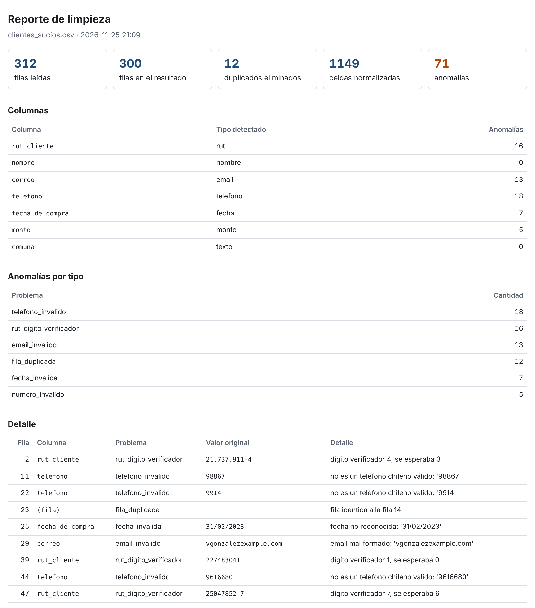

# limpiador-datos

[](https://github.com/sebakine/limpiador-datos/actions/workflows/ci.yml)


[](LICENSE)

Herramienta de línea de comandos que limpia y valida archivos CSV y Excel con datos de clientes o ventas de Chile. Normaliza RUT, teléfonos, emails, fechas y montos, elimina duplicados y entrega un reporte con cada anomalía encontrada, indicando la fila del archivo original.

Está pensada para el trabajo que hoy se hace a mano en operaciones y finanzas: revisar exportaciones de un ERP o de un formulario antes de cargarlas a otro sistema.

```console
$ limpiador limpiar examples/clientes_sucios.csv -r reporte.html -e examples/esquema.toml
 Limpieza de clientes_sucios.csv
┌───────────────────────┬──────┐
│ Filas leídas          │ 312  │
│ Filas en el resultado │ 300  │
│ Duplicados eliminados │ 12   │
│ Celdas normalizadas   │ 1149 │
│ Anomalías             │ 71   │
└───────────────────────┴──────┘
  • telefono_invalido: 18
  • rut_digito_verificador: 16
  • email_invalido: 13
  • fila_duplicada: 12
  • fecha_invalida: 7
  • numero_invalido: 5
✓ Resultado en examples/clientes_sucios_limpio.csv
✓ Reporte en reporte.html
```



## Qué hace

| Antes | Después | Regla |
| --- | --- | --- |
| `12.345.678-5`, `123456785` | `12345678-5` | RUT sin puntos, con guion; valida el dígito verificador (módulo 11) |
| `9 8765 4321`, `(+56) 9-8765-4321`, `87654321` | `+56987654321` | Teléfono chileno en formato E.164, móviles y fijos |
| ` Juan@Mail.CL ` | `juan@mail.cl` | Email en minúsculas y sin espacios; detecta los mal formados |
| `01/02/2024`, `3 de marzo de 2024`, `20240201` | `2024-02-01` | Fechas en formato ISO; día/mes/año por defecto |
| `$1.234.567`, `1.234,50`, `2.298.664 CLP` | `1234567`, `1234.5`, `2298664` | Montos con separadores chilenos o estadounidenses |
| `  ANA   DE LA fuente ` | `Ana de la Fuente` | Nombres propios con mayúsculas correctas en español |

Además:

- **Duplicados**: elimina filas idénticas después de normalizar (`12.345.678-5` y `12345678-5` son la misma persona) y, si defines una clave, filas que la repiten.
- **Nulos**: reconoce `""`, `N/A`, `null`, `-`, `S/I` y similares como vacíos, y avisa cuando falta una columna obligatoria.
- **Sin pérdida silenciosa**: un valor que no se puede corregir queda vacío en el resultado y su valor original aparece en el reporte con la fila y el motivo.
- **Archivos reales**: detecta la codificación (UTF-8 o Windows-1252) y el separador (`,` o `;`, como exporta Excel en Chile), lee todo como texto para no perder ceros ni la `K` del RUT y convierte los encabezados a `snake_case`.

## Instalación

Requiere Python 3.11 o superior.

```bash
pip install "git+https://github.com/sebakine/limpiador-datos"
# o, para incluir el generador de datos de ejemplo:
pip install "limpiador-datos[ejemplos] @ git+https://github.com/sebakine/limpiador-datos"
```

## Uso

```bash
# Ver qué tipo detecta en cada columna antes de limpiar
limpiador perfilar ventas.xlsx --hoja Clientes

# Limpiar y obtener el reporte en Excel (hojas Resumen, Anomalías y Columnas) o HTML
limpiador limpiar ventas.csv -o ventas_limpias.xlsx -r reporte.xlsx

# En un pipeline: termina con código 1 si encuentra anomalías
limpiador limpiar ventas.csv --estricto

# Generar un archivo de prueba con errores típicos
limpiador ejemplo clientes_sucios.csv --filas 1000 --semilla 7
```

### Esquema opcional

Los tipos se infieren por el nombre de la columna (`rut`, `correo`, `telefono`, `fecha_*`, `monto`, `nombre`...). Cuando no basta, un archivo TOML fija las reglas:

```toml
required = ["rut_cliente", "fecha_de_compra"]                # no pueden venir vacías
unique_keys = ["rut_cliente", "fecha_de_compra", "monto"]    # identifican una venta
dayfirst = true                                              # fechas día/mes/año

[columns]
codigo_cliente = "rut"     # tipos: rut, telefono, email, fecha, monto, nombre, texto
```

### Como librería

```python
from pathlib import Path
from limpiador import Schema, clean_dataframe
from limpiador.io import read_table

result = clean_dataframe(read_table(Path("ventas.csv")), Schema(unique_keys=["rut"]))
result.data                 # DataFrame limpio
result.anomalies_frame()    # una fila por anomalía
```

## Diseño

```text
CSV / Excel ──► io.read_table ──► cleaner.clean_dataframe ──► io.write_table ──► CSV / Excel limpio
                (codificación,     │  por columna: schema decide el tipo,
                 separador,        │  validators normaliza cada celda
                 snake_case)       │  luego: deduplicación
                                   └──► report.write_report ──► reporte .xlsx / .html
```

- `validators.py`: funciones puras, una por tipo de dato, sin pandas. Devuelven el valor normalizado o el problema encontrado. Son la parte con más casos borde, así que tienen tests parametrizados y pruebas basadas en propiedades con Hypothesis (por ejemplo, cualquier RUT con su dígito verificador correcto debe validar).
- `schema.py`: inferencia de tipos por nombre y esquema TOML validado.
- `cleaner.py`: aplica los validadores, registra anomalías con la fila del archivo y elimina duplicados.
- `report.py`: reporte Excel con estilos y reporte HTML autocontenido, con escape de valores para que un dato malicioso no ejecute código al abrirlo.
- `cli.py`: interfaz con Typer y Rich.

Decisiones:

- **Todo se lee como texto.** pandas convertiría `0223456789` en número y `12345678-K` en error; leer como texto y normalizar después evita perder información.
- **Un valor inválido queda vacío, no se adivina.** Corregir automáticamente un RUT con dígito verificador incorrecto podría asignar una venta a otra persona.
- **Dependencias mínimas.** Faker solo se instala para el generador de ejemplos.

## Desarrollo

Usa [uv](https://docs.astral.sh/uv/).

```bash
make install   # uv sync
make check     # ruff, mypy --strict y pytest con cobertura
make demo      # genera datos sucios y los limpia
```

La integración continua (GitHub Actions) corre lint, tipos y tests en Linux con Python 3.11, 3.12 y 3.13, en Windows y macOS, y una vez más con las versiones mínimas de las dependencias. Luego construye el paquete y valida sus metadatos.

## Licencia

[MIT](LICENSE) © Sebastián Muñoz
